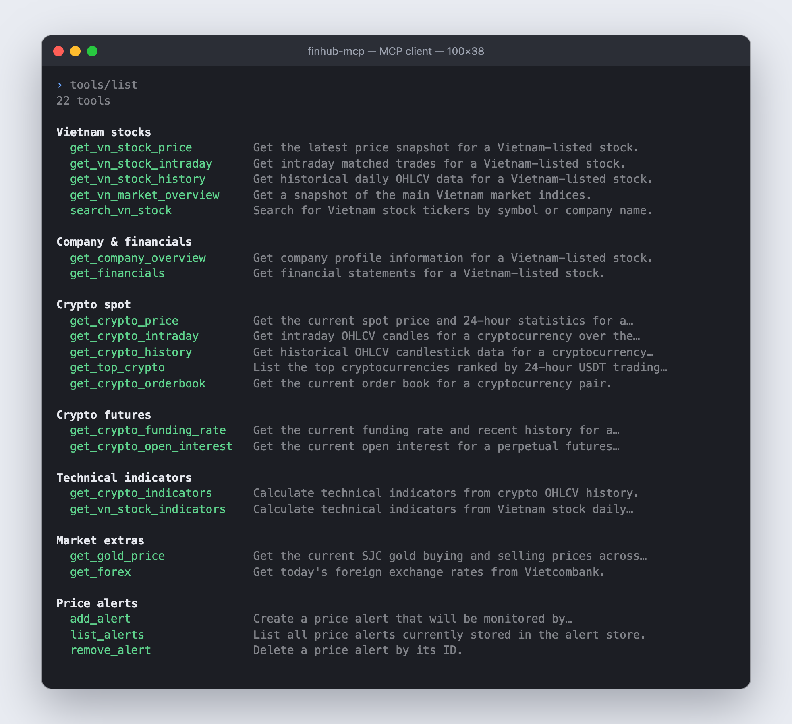
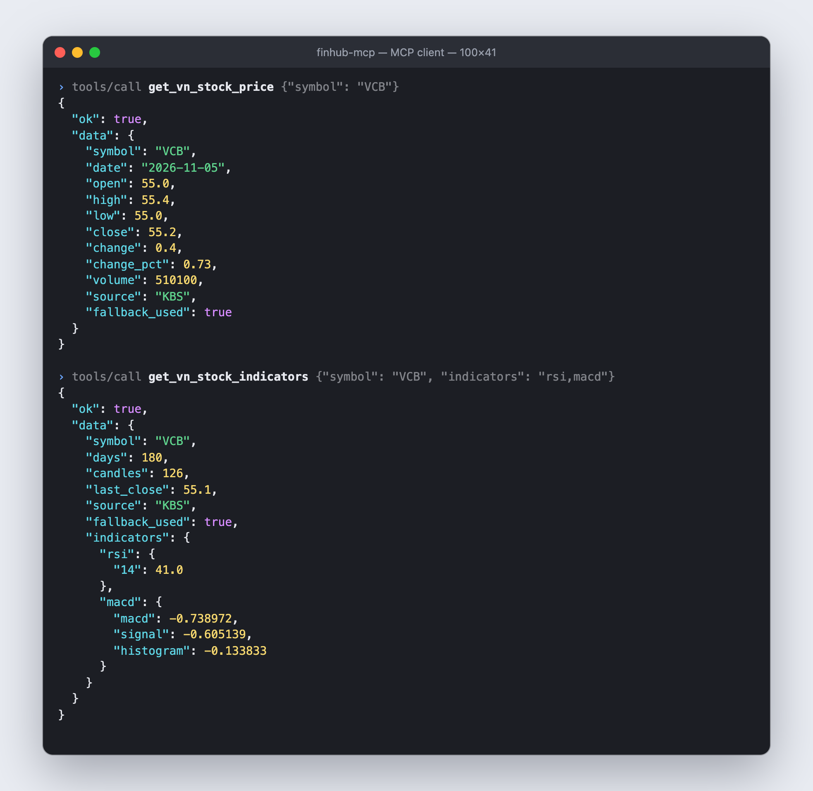
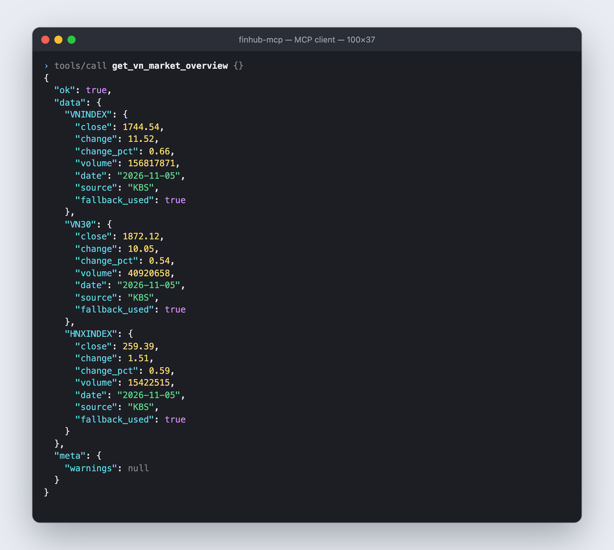
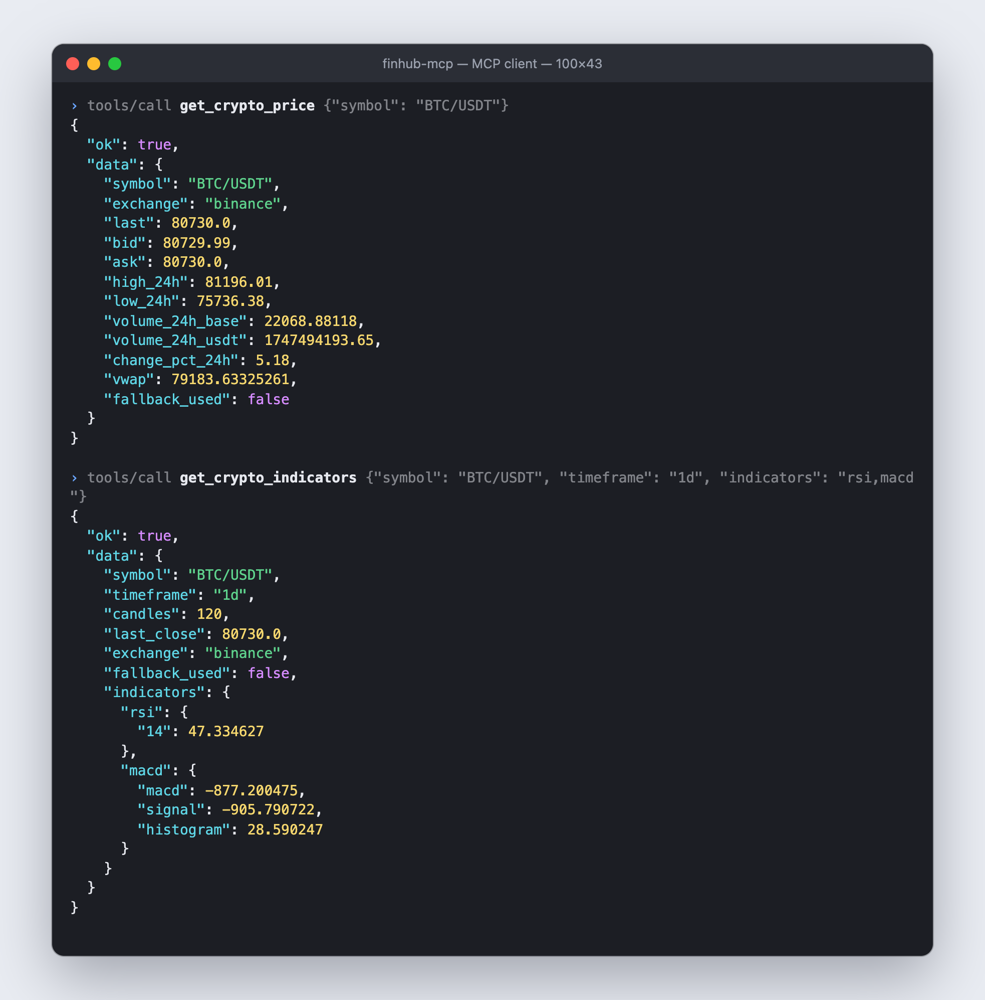
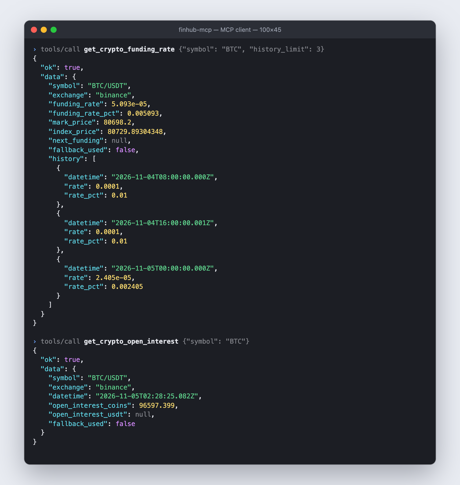
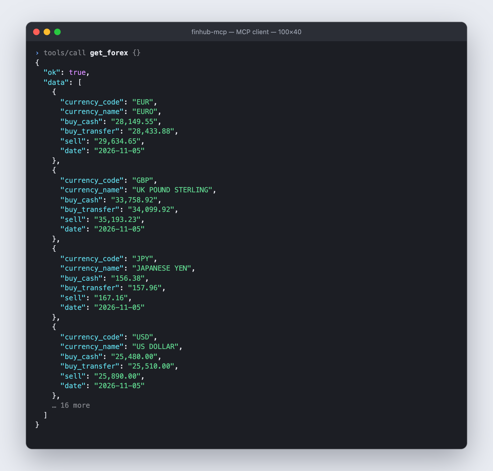
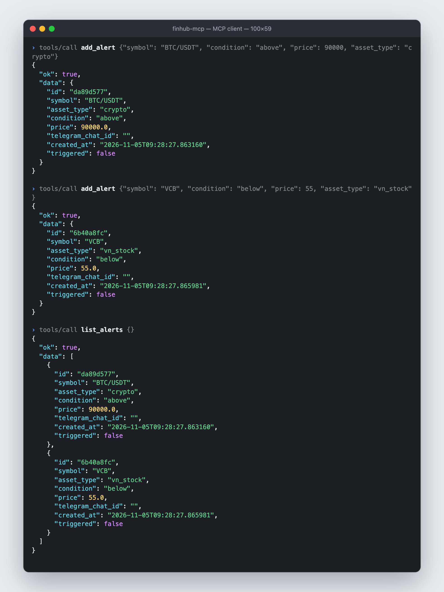

# FinHub MCP

> Copyright (c) 2026 bachbnt. All rights reserved.

A local [Model Context Protocol (MCP)](https://modelcontextprotocol.io) server for financial market data: Vietnam stocks, crypto spot and perpetual futures, gold, forex, and price alerts.

## Latest

- Added free provider fallback for Vietnam stocks and crypto market data.
- Added Vietnam stock intraday matched trades via `get_vn_stock_intraday`.
- Added crypto intraday OHLCV for the last 1-24 hours via `get_crypto_intraday`.
- Added source/exchange metadata in fallback-aware responses.
- Updated alert daemon to use the same fallback model for crypto and Vietnam stock prices.
- Suppressed noisy `vnstock` banners/logging so MCP stdio stays clean.
- Added in-memory TTL caching, shared ccxt instances with timeouts, a provider cooldown for dead sources, and non-blocking (threaded) tools.
- Alert daemon prices each symbol once per pass, redacts the Telegram token from logs and prunes old triggered alerts.
- Fixed RSI/EMA/MACD to match standard definitions; list responses carry source info in `meta` and JSON is compact.
- Added 16 tools (38 total): batch prices, VN top movers / breadth / foreign trading / screener, crypto long-short ratio / liquidations / Fear & Greed / basis, world forex and gold, RSS news with sentiment.
- Added ATR, Stochastic, VWAP, volume MA, support/resistance and crossover signals (golden/death cross) to both indicator tools.
- Added MCP resources (alerts, config, indicator glossary, usage guide, company profile), six ready-made prompts, and an optional authenticated HTTP/SSE transport.
- Added background running: a launchd control script with click-to-run `.command` files (macOS) and a hardened Docker setup. vnstock is now an optional dependency.

## Features

| Category | Tools |
|---|---|
| Vietnam stocks | Latest price (single or batch), intraday trades, OHLCV history, market indices overview, symbol search |
| Vietnam market | Top gainers/losers, most traded, market breadth (advancers/decliners), foreign trading (khối ngoại), stock screener |
| Company & financials | Company profile, income statement, balance sheet, cash flow, ratios |
| Crypto spot | Price ticker (single or batch), intraday OHLCV, OHLCV history, top by volume, order book, recent trades |
| Crypto futures & sentiment | Funding rate and history, open interest, long/short ratio, liquidations, spot-futures basis, Fear & Greed index |
| Technical indicators | SMA, EMA, RSI, MACD, Bollinger Bands, ATR, Stochastic, VWAP, volume MA, support/resistance, crossover signals for crypto and Vietnam stocks |
| Market extras | SJC gold price, Vietcombank forex rates |
| World markets | International forex rates and history, gold/silver/platinum/palladium spot price and history |
| News | RSS headlines from CafeF, Vietstock, VnExpress, Cointelegraph, Decrypt with keyword sentiment |
| Price alerts | Create, list, and delete alerts; optional Telegram notification daemon |

## Screenshots

Real responses from the server, captured with an MCP client on 2026-11-05 (market data changes all the time).

| All tools (`tools/list`) | Vietnam stock price and indicators |
|:-:|:-:|
|  |  |

| Vietnam market overview | Crypto price and indicators |
|:-:|:-:|
|  |  |

| Funding rate and open interest | Vietcombank forex rates |
|:-:|:-:|
|  |  |

<details>
<summary>Price alerts (<code>add_alert</code>, <code>list_alerts</code>)</summary>



</details>

## Requirements

- Python 3.11+
- `pip` or `uv`
- Optional Telegram bot token for alert notifications

Install dependencies:

```bash
python3 -m venv .venv
source .venv/bin/activate
pip3 install -r requirements.txt
```

Vietnam stock data additionally needs `vnstock` 4.x, which is optional and **no longer installable from PyPI**: see [Vietnam data (vnstock)](#vietnam-data-vnstock). Crypto, world forex and metals, news and alerts work without it.

## MCP Setup

Add this server to your Claude Code MCP config:

```json
{
  "mcpServers": {
    "finhub": {
      "command": "/path/to/finhub-mcp/.venv/bin/python",
      "args": ["/path/to/finhub-mcp/server.py"]
    }
  }
}
```

Restart Claude Code after changing MCP tool signatures so the client reloads the schema.

## Provider Fallback

Default `auto` mode uses free public sources and falls back when a provider errors or returns empty data.

| Area | Default fallback order |
|---|---|
| VN quote/history | `VCI -> KBS -> MSN` |
| VN intraday | `KBS -> VCI -> MSN` |
| VN listing/company/financials | `VCI -> KBS` |
| Crypto spot/futures | `binance -> okx -> bybit -> kucoin -> gate -> mexc` |
| VN price board (movers, breadth, foreign, screener) | `KBS` |
| Long/short ratio | `binance -> okx -> bybit` |
| Liquidations | `okx -> gate` |
| World forex | `Yahoo -> ER-API` |
| World metals | `gold-api.com -> Yahoo futures` |

You can pass a single provider or comma-separated fallback list, for example:

```text
source="KBS"
source="KBS,VCI"
exchange="okx,binance"
```

Responses include `source` or `exchange` plus `fallback_used` where applicable. For single objects these are fields of `data`; for lists (history, trades, search, financials...) they are in `meta`, so they are not repeated on every row.

A provider that fails with a network error (timeout, connection reset) is skipped for `provider_cooldown_seconds` (default 30s) instead of being retried and waited on by every call. If every provider is cooling down they are all tried anyway. Crypto exchange requests time out after `crypto_timeout_ms` (default 10s).

Provider order, caching, timeouts and alert storage can be configured in `config.json`.

## Caching

Successful provider responses are cached in memory for the TTLs under `cache_ttl_seconds` (set a value to `0` to disable):

| Key | Default | Applies to |
|---|---|---|
| `ticker` | 10s | Crypto tickers, latest VN stock price, VN price board, liquidations, basis, world forex/metal quotes |
| `history` | 300s | Daily VN history, company profile, financials, symbol listing, long/short ratio, Fear & Greed, world history. Crypto candles are cached for at most a quarter of the candle length (1m candles ~15s) |
| `market_overview` | 60s | VN index overview, SJC gold, Vietcombank forex, ER-API rates |
| `news` | 300s | RSS feeds |

Errors are never cached. Order books, trades, funding rate, open interest and intraday data are always fetched live.

## Response Format

All MCP tools return a JSON string with a stable envelope:

```json
{
  "ok": true,
  "data": {}
}
```

Errors use the same envelope:

```json
{
  "ok": false,
  "error": "message",
  "meta": {
    "error_type": "validation",
    "retryable": false
  }
}
```

Provider fallback failures include structured metadata:

```json
{
  "ok": false,
  "error": "All providers failed (...)",
  "meta": {
    "error_type": "provider_failure",
    "retryable": true,
    "provider_errors": {
      "binance": "timeout",
      "okx": "symbol not found"
    }
  }
}
```

## Configuration

Runtime defaults live in `config.json`:

```json
{
  "crypto_exchanges": ["binance", "okx", "bybit"],
  "vn_quote_sources": ["VCI", "KBS", "MSN"],
  "alert_store": "alerts.json",
  "alert_retention_days": 30,
  "crypto_timeout_ms": 10000,
  "provider_cooldown_seconds": 30,
  "http_timeout_seconds": 10,
  "vn_board_sources": ["KBS"],
  "cache_ttl_seconds": {
    "ticker": 10,
    "history": 300,
    "market_overview": 60,
    "news": 300
  },
  "news_feeds": {
    "my_feed": {"name": "My feed", "url": "https://example.com/rss", "group": "vn", "lang": "vi"},
    "vnexpress_business": {"enabled": false}
  }
}
```

`news_feeds` is merged with the built-in feeds (CafeF, Vietstock, VnExpress, Cointelegraph, Decrypt), so you only list what you add or switch off. Each feed needs a `url`; `group` (used by `source="vn"` / `"crypto"`) and `lang` are optional.

`config.json` is re-read automatically when the file changes (provider lists are read once at startup, so restart the server after editing them). `alert_retention_days` controls how long triggered alerts are kept before the daemon deletes them (`0` keeps them forever).

Relative paths are resolved from the project root. Set `FINHUB_CONFIG=/path/to/config.json` to use another file.

## Resources and Prompts

Besides tools, the server exposes MCP **resources** (read-only context you attach) and **prompts** (ready-made workflows). In Claude Code, type `@` to attach a resource and `/` to run a prompt (they appear as `/mcp__finhub__<name>`).

| Resource | Content |
|---|---|
| `finhub://alerts` | Pending and triggered alerts, Telegram chat ids masked |
| `finhub://config` | Effective provider order, cache TTLs, timeouts, news feeds. No credentials |
| `finhub://indicators/glossary` | Exact definition, thresholds and minimum candles of every indicator and signal. Generated from the same constants the code uses |
| `finhub://guide/usage` | Which tool to use, units (VN prices in thousand VND), response format, data caveats |
| `finhub://vn/{symbol}/overview` | Company profile for a Vietnam-listed ticker (e.g. `finhub://vn/FPT/overview`) |

| Prompt | Arguments | What it does |
|---|---|---|
| `technical_analysis` | `symbol`, `market` (`crypto` or `vn`), `timeframe` | Trend, momentum, volatility, levels and volume report, plus derivatives context for crypto or foreign flow and news for VN stocks |
| `vn_market_brief` | none | Indices, breadth, top movers, foreign flow, headlines |
| `crypto_market_brief` | `symbols` (default `BTC,ETH,SOL`) | Prices, Fear & Greed, funding / long-short / basis / liquidations, most active, headlines |
| `gold_vs_sjc` | none | SJC price against the world gold price converted to VND per lượng |
| `news_digest` | `topic`, `hours` | Themed news summary with sentiment |
| `alert_levels` | `symbol`, `market`, `timeframe` | Proposes alerts at support/resistance and creates only the ones you approve |

Prompt arguments are validated before they are placed in the prompt text (tickers must look like tickers, timeframes like `4h`, free text is stripped of control characters and capped), so an argument cannot smuggle instructions into the prompt. Every prompt tells the model to use only returned numbers, relay warnings, and state that the result is not investment advice.

## HTTP transport

By default the server speaks **stdio**: Claude Code launches it as a child process. That is the simplest and safest setup for one person on one machine. To run it as a standalone service that several clients share (and that shares one cache), use an HTTP transport:

```bash
export FINHUB_HTTP_TOKEN="$(python server.py --generate-token)"
python server.py --transport streamable-http        # http://127.0.0.1:8000/mcp
python server.py --transport sse                    # legacy SSE: http://127.0.0.1:8000/sse
```

| Flag / variable | Default | Meaning |
|---|---|---|
| `--transport` / `FINHUB_TRANSPORT` | `stdio` | `stdio`, `streamable-http` (recommended) or `sse` |
| `--host` / `FINHUB_HOST` | `127.0.0.1` | Bind address. `0.0.0.0` exposes it to the network |
| `--port` / `FINHUB_PORT` | `8000` | Port |
| `FINHUB_HTTP_TOKEN` | none | Bearer token, at least 16 characters. Read from the environment only, never from a flag, so it does not appear in `ps` |
| `--no-auth` | off | Disable auth. Only accepted on a loopback address |
| `--allow-host` / `FINHUB_ALLOWED_HOSTS` | none | Extra `Host` values (e.g. `finhub.example.com:*`); turns on DNS-rebinding protection |

The server has tools that write data (`add_alert`, `remove_alert`), so the HTTP modes are locked down by default:

- Auth is required. Without `FINHUB_HTTP_TOKEN` the server refuses to start (exit code 2) unless you pass `--no-auth` **and** bind to a loopback address. `--no-auth` on `0.0.0.0` is rejected.
- Every request needs `Authorization: Bearer <token>`; tokens are compared in constant time, and a token in the query string is not accepted. `GET /healthz` is the only unauthenticated path and returns `{"status":"ok"}`.
- It binds to `127.0.0.1` unless you say otherwise. If you expose it beyond your machine, put it behind TLS (a reverse proxy); the token travels in a header and must not cross the network in clear text.

Connect Claude Code to it:

```bash
claude mcp add --transport http finhub http://127.0.0.1:8000/mcp --header "Authorization: Bearer $FINHUB_HTTP_TOKEN"
```

## Tool Reference

### Vietnam Stocks

| Tool | Description |
|---|---|
| `get_vn_stock_price(symbol, source="auto")` | Latest OHLCV snapshot and day-over-day change |
| `get_vn_stock_intraday(symbol, period="latest", limit=100, page_size=100, pages=5, source="auto")` | Matched trades for today or latest session |
| `get_vn_stock_history(symbol, days=30, source="auto")` | Daily OHLCV history for 1-365 calendar days |
| `get_vn_market_overview(source="auto")` | VNINDEX, VN30, and HNXINDEX snapshot |
| `search_vn_stock(query, source="auto")` | Search by ticker or company name |

`get_vn_stock_intraday` supports:

- `period="latest"`: most recent trading session.
- `period="today"`: strict current calendar day; may return an empty list on weekends/holidays.

### Company & Financials

| Tool | Description |
|---|---|
| `get_company_overview(symbol, source="auto")` | Company profile, sector, market cap, listing metadata |
| `get_financials(symbol, statement="income_statement", period="year", source="auto")` | Financial statements and ratios |

Supported `statement` values: `income_statement`, `balance_sheet`, `cash_flow`, `ratio`.

Supported `period` values depend on the upstream source, commonly `year` and `quarter`.

### Crypto Spot

| Tool | Description |
|---|---|
| `get_crypto_price(symbol, exchange="auto")` | Ticker, bid/ask, 24h high/low, volume, VWAP |
| `get_crypto_intraday(symbol, timeframe="5m", hours=24, max_candles=1000, exchange="auto")` | OHLCV candles for the last 1-24 hours |
| `get_crypto_history(symbol, timeframe="1d", limit=30, exchange="auto")` | Historical OHLCV candles |
| `get_top_crypto(limit=10, exchange="auto")` | Top USDT pairs by 24h quote volume |
| `get_crypto_orderbook(symbol, depth=10, exchange="auto")` | Bid/ask depth and spread |
| `get_crypto_trades(symbol, limit=20, exchange="auto")` | Recent public trades |
| `get_crypto_indicators(symbol, timeframe="1d", limit=120, indicators="sma,ema,rsi,macd,bollinger", exchange="auto")` | Technical indicators from OHLCV |

Symbols may be base assets like `BTC` or full pairs like `BTC/USDT`.

Common timeframes: `1m`, `5m`, `15m`, `1h`, `4h`, `1d`, `1w`.

### Crypto Futures

| Tool | Description |
|---|---|
| `get_crypto_funding_rate(symbol, exchange="auto", history_limit=8)` | Current funding rate plus recent history |
| `get_crypto_open_interest(symbol, exchange="auto")` | Current perpetual futures open interest |

### Vietnam Market (price board)

All of these use the KBS price board, so they only return trading data while the market is open (or the last session's data after close). Prices are in thousand VND, matching `get_vn_stock_price`. `group` is one of `HOSE`, `HNX`, `UPCOM`, `VN30`, `VN100`, `ALL`.

| Tool | Description |
|---|---|
| `get_vn_stock_prices(symbols, source="auto")` | Live price, change, volume, traded value and foreign net volume for up to 100 tickers |
| `get_vn_top_movers(group="HOSE", by="change_pct", limit=10, min_value_bn=1.0)` | Top gainers and losers (`by="change_pct"`), or most traded by `volume` / `value`. `min_value_bn` hides illiquid names |
| `get_vn_market_breadth(group="ALL")` | Advancers, decliners, unchanged, ceiling/floor counts, turnover, foreign totals (per exchange for `ALL`) |
| `get_vn_foreign_trading(group="HOSE", limit=10)` | Foreign net buy/sell leaders and totals |
| `screen_vn_stocks(group, min_price, max_price, min_change_pct, max_change_pct, min_volume, min_value_bn, foreign_net, status, sort_by, descending, limit)` | Screen by today's trading data. `foreign_net`: `any`/`buy`/`sell`; `status`: `any`/`ceiling`/`floor`; `sort_by`: `value`/`volume`/`change_pct`/`price`/`foreign_net` |

Notes: the board only carries foreign *volumes*, so foreign net *values* are estimates (net volume x average price). The screener works on live trading data, not fundamentals such as P/E or market cap. Before the first trade of the day, prices show the reference price and every response carries a "No trades yet" warning.

### Crypto Derivatives & Sentiment

| Tool | Description |
|---|---|
| `get_crypto_prices(symbols, exchange="auto")` | Spot prices and 24h stats for up to 50 coins in one call, e.g. `"BTC,ETH,SOL"`. Coins missing on one exchange are tried on the next; any left are in `meta.missing` |
| `get_crypto_long_short_ratio(symbol, timeframe="1h", limit=24, exchange="auto")` | Long/short account ratio history (Binance, OKX, Bybit) with a crowding summary |
| `get_crypto_liquidations(symbol, limit=50, exchange="auto")` | Recent forced liquidations on a perpetual swap (OKX, Gate) with long/short totals |
| `get_crypto_basis(symbol, exchange="auto")` | Perpetual and nearest dated futures against spot: basis, basis % and annualized % |
| `get_crypto_fear_greed(days=1)` | Crypto Fear & Greed Index from alternative.me (0 = extreme fear, 100 = extreme greed) |

Binance and Bybit expose no public liquidation feed over REST, so liquidations come from OKX and Gate and cover only the most recent orders they return. Basis uses the bid/ask midpoint because the last price of illiquid dated futures is often stale.

### World Markets

| Tool | Description |
|---|---|
| `get_world_forex(pairs="EURUSD,GBPUSD,USDJPY,USDVND")` | International spot rates with day-over-day change (max 20 pairs) |
| `get_world_forex_history(pair, days=30, interval="1d")` | OHLC history. Intervals: `1m`, `5m`, `15m`, `30m`, `1h`, `1d`, `1wk`, `1mo`; intraday look-back is limited by Yahoo (1m: 7 days, 5-30m: 59, 1h: 729) |
| `get_world_metal_price(metal="XAU")` | USD per troy ounce for gold `XAU`, silver `XAG`, platinum `XPT`, palladium `XPD`. Gold also returns an estimate of the VND price per lượng (37.5 g) from the live USD/VND rate, for comparing with SJC; it excludes tax, premium and fees |
| `get_world_metal_history(metal="XAU", days=30, interval="1d")` | OHLC history of the metal futures (`GC=F`, `SI=F`, `PL=F`, `PA=F`); futures differ slightly from spot |

### News

| Tool | Description |
|---|---|
| `get_market_news(source="auto", query="", limit=15, hours=48, include_sentiment=True)` | Recent headlines, newest first. `source`: `auto`, a group (`vn`, `crypto`) or feed keys. `query` words must all appear in the title/summary (accent-insensitive, so `co phieu` matches `cổ phiếu`) |
| `get_news_sentiment(query="", source="auto", hours=48)` | Aggregate sentiment overall and per source, with the most positive and negative headlines |

Sentiment is a keyword lexicon (Vietnamese and English) scored in [-1, 1], with the headline weighted double the summary. Longer phrases win over their parts (`giảm lỗ`, narrowing losses, is positive; `lãi suất`, interest rate, is neutral). It is a rough read on tone, not a model and not a forecast. A feed that fails shows up in `meta.warnings` and the other feeds still answer. Some networks block individual publishers (VnExpress and Cointelegraph reset connections in the environment this was developed in), which is why feeds are configurable.

### Technical Indicators

| Tool | Description |
|---|---|
| `get_crypto_indicators(symbol, timeframe="1d", limit=120, indicators="sma,ema,rsi,macd,bollinger", exchange="auto")` | Technical indicators from crypto OHLCV |
| `get_vn_stock_indicators(symbol, days=180, indicators="sma,ema,rsi,macd,bollinger", source="auto")` | Same indicators from Vietnam stock daily history |

Use `indicators="rsi,sma"` to request a subset, or `indicators="all"` for everything:

| Indicator | Output |
|---|---|
| `sma`, `ema`, `rsi`, `macd`, `bollinger` | SMA20/50, EMA12/26, RSI14, MACD(12,26,9), Bollinger(20,2). The default set |
| `atr` | ATR14 (Wilder) and ATR as % of close |
| `stochastic` | Slow stochastic (14,3,3): %K, %D and overbought/oversold state |
| `vwap` | VWAP over the fetched window and the close's distance from it |
| `volume_ma` | Volume SMA20/50 and the last volume relative to SMA20 |
| `support_resistance` | Nearest swing-pivot support/resistance clusters (with touch counts) and classic pivot points |
| `signals` | SMA20/50 and SMA50/200 (golden/death cross) state and recent cross, MACD cross, RSI and Bollinger state, and a simple bullish/bearish bias score |

`signals` needs about 200 candles for the golden/death cross (use `limit=250` for crypto and `days=365` for VN stocks). The crossover lookback is the last 5 candles. The last candle may still be forming, which affects `volume_ma` and `vwap`.

RSI uses Wilder's smoothing and EMAs are seeded with an SMA, so values match common charting tools. Indicators that lack enough candles are returned as `null` (SMA50 needs 50 candles, the MACD signal line needs 34). To make the defaults usable, `limit` for crypto is clamped to 60-1000 candles and `days` for VN stocks to 90-365.

### Market Extras

| Tool | Description |
|---|---|
| `get_gold_price()` | SJC gold buy/sell prices |
| `get_forex()` | Vietcombank exchange rates |

### Alerts

| Tool | Description |
|---|---|
| `add_alert(symbol, condition, price, asset_type="crypto", telegram_chat_id="")` | Create a price alert |
| `list_alerts()` | Show alert store contents |
| `remove_alert(alert_id)` | Delete an alert |

`condition` must be `above` or `below`. `asset_type` supports `crypto` and `vn_stock`.

## Vietnam data (vnstock)

The Vietnam tools use the `vnstock` package, pinned to the 4.x series, as an **optional** dependency (`pip install -e ".[vn]"`, or `requirements-vn.txt`). Without it the Vietnam tools return a clear "vnstock is not installed" error and everything else keeps working.

Two things to know:

- **vnstock 4.x can no longer be installed from PyPI or from the vendor's package index.** The copy in your existing `.venv` is the only one you have. If you delete the venv, change machines or build in CI, you cannot get it back. Keep a copy: `.venv/bin/python scripts/freeze_vnstock.py` saves the installed `vnstock` and `vnai` into `docker/vendor/` (git-ignored; third-party code, do not commit or redistribute it). The Docker image uses that copy.
- **vnstock 6 is not a drop-in upgrade.** It dropped the free KBS/VCI/MSN sources: every Vietnam source (SSI, DNSE, TCBS, FHSC) needs an API key from your own brokerage account, and the Vietcombank rate table is gone. This project stays on 4.x for now; moving to 6 would mean a dual-backend layer verified against your own keys.

Continuous integration installs the project without vnstock, so the tests do not depend on it.

## Running in the background

`alert_daemon.py` only watches prices while it is running. Two ways to keep it running; **pick one**, because each keeps its own alert store (alerts created through a stdio server on your machine are not seen by a daemon inside Docker, and the reverse).

| | launchd (macOS) | Docker |
|---|---|---|
| Starts at login, restarts on crash | yes | yes (Docker Desktop must start at login) |
| MCP server | your normal stdio server, unchanged | HTTP server in a container (`streamable-http`) |
| Keeps vnstock 4.x reproducible | no | yes (via `docker/vendor/`) |
| Needs the project outside Desktop/Documents/Downloads | **yes** | no |

### launchd (macOS)

Everything is driven by `scripts/daemon.sh`, which installs a per-user LaunchAgent (no sudo, nothing outside your home folder):

| Command | Does |
|---|---|
| `scripts/daemon.sh start` | Installs (first time) and starts the daemon; it also starts at every login |
| `scripts/daemon.sh stop` | Stops it now **and keeps it off** at login until you run `start` again |
| `scripts/daemon.sh restart` | Restarts it |
| `scripts/daemon.sh status` | Running or not, last exit code, recent log lines (exit code 0 only when running) |
| `scripts/daemon.sh logs [-f]` | Shows (or follows) the log |
| `scripts/daemon.sh uninstall` | Stops it and removes the agent |
| `scripts/daemon.sh plist` | Prints the plist `start` would install, changing nothing |

If you prefer not to use a terminal, double-click the files in `scripts/` from Finder: **FinHub Daemon - Start**, **- Stop**, **- Status** and **- Uninstall** (`.command`). Each opens Terminal, runs the matching command, shows the result and waits for a key press. (If macOS blocks the first launch, right-click the file and choose Open.)

Notes:

- Use `stop`, not `kill`: the agent restarts the daemon after a crash, so a plain `kill` makes launchd start it again. Logs are in `~/Library/Logs/finhub-mcp/`.
- `TELEGRAM_BOT_TOKEN` stays in the project's `.env` (which the daemon reads itself); it is never written into the plist. `start` warns if `.env` is readable by other users (`chmod 600 .env`).
- **macOS blocks background jobs from reading `~/Desktop`, `~/Documents`, `~/Downloads`, iCloud Drive and external volumes.** If the project (or its `.venv`) is in one of them, Python starts and then hangs silently while opening its venv (verified: the same job works from `/tmp` and hangs from `~/Desktop`). `start` detects this and refuses with the options: move the project (for example `mv ~/Desktop/source/finhub-mcp ~/Developer/finhub-mcp`; the `.venv` keeps working after the move, then update the path in your Claude MCP config), use Docker, or grant Full Disk Access to the Python binary (not recommended).
- After starting, `start` waits for the daemon's first output line and warns if there is none.

### Docker

The image runs both the HTTP MCP server and the alert daemon (`docker-compose.yml`), sharing an `alerts` volume.

```bash
cp .env.example .env                     # set FINHUB_HTTP_TOKEN (python server.py --generate-token) and, for Telegram, TELEGRAM_BOT_TOKEN
.venv/bin/python scripts/freeze_vnstock.py   # once: includes Vietnam data (skip it and the Vietnam tools report vnstock missing)
docker compose up -d --build
claude mcp add --transport http finhub http://127.0.0.1:8000/mcp --header "Authorization: Bearer $FINHUB_HTTP_TOKEN"
```

| Command | Does |
|---|---|
| `docker compose up -d --build` | Build and start both services (restart automatically unless you stop them) |
| `docker compose stop` / `start` | Pause and resume, keeping alerts |
| `docker compose logs -f daemon` | Watch the daemon |
| `docker compose down` | Remove the containers; **alerts are kept** in the volume |
| `docker compose down -v` | Remove everything, **including the alerts** |

What it sets up:

- Non-root user, read-only root filesystem, all Linux capabilities dropped, `no-new-privileges`. Only `/data` (alerts) and a small tmpfs are writable.
- The server refuses to start without `FINHUB_HTTP_TOKEN`, and the port is published on `127.0.0.1` only (override with `FINHUB_PORT`). Put a TLS reverse proxy in front before exposing it further.
- The daemon gets `TELEGRAM_BOT_TOKEN` from `.env` but not the HTTP token; the server gets the HTTP token but not the Telegram token. `.env` and `alerts.json` are not copied into the image.
- To bring existing alerts across: `docker compose cp alerts.json mcp:/data/alerts.json`, then `docker compose exec -u 0 mcp chown finhub /data/alerts.json`.
- Docker Desktop must itself start at login (Settings, General, "Start Docker Desktop when you sign in") for the services to come back after a reboot.
- The image contains the vendored vnstock: keep it local and do not push it to a public registry.

## Alert Daemon

The MCP server writes alerts to `alerts.json`. The daemon polls that file and sends Telegram notifications when conditions are met.

```bash
python alert_daemon.py
```

If installed as a package, use:

```bash
finhub-alert-daemon
```

Telegram setup:

1. Create a bot with [@BotFather](https://t.me/BotFather).
2. Send `/start` to the bot.
3. Open `https://api.telegram.org/bot<TOKEN>/getUpdates`.
4. Copy the chat ID.
5. Set `TELEGRAM_BOT_TOKEN` in `.env`.
6. Pass the chat ID to `add_alert`.

## Environment Variables

| Variable | Required | Default | Description |
|---|---|---|---|
| `TELEGRAM_BOT_TOKEN` | No | empty | Telegram bot token for alert delivery |
| `CHECK_INTERVAL` | No | `60` | Alert daemon polling interval in seconds |
| `FINHUB_HTTP_TOKEN` | For HTTP | none | Bearer token for the HTTP/SSE transports (16+ characters) |
| `FINHUB_ALERT_STORE` | No | `alert_store` in `config.json` | Path of the alerts file; overrides `config.json` (Docker sets it to `/data/alerts.json`) |
| `FINHUB_CONFIG` | No | `config.json` | Use another config file |

## Development

The codebase is split by responsibility:

| Path | Purpose |
|---|---|
| `server.py` | MCP entrypoint: registration of tools/resources/prompts and transport selection (stdio, HTTP, SSE) |
| `finhub_mcp/providers.py` | Shared `vnstock` and `ccxt` adapters, provider fallback with cooldown, input helpers |
| `finhub_mcp/services.py` | Cached data access shared by the tools and the alert daemon |
| `finhub_mcp/cache.py` | In-memory TTL cache driven by `cache_ttl_seconds` |
| `finhub_mcp/http.py` | Shared HTTP client (timeout, size cap) for the JSON/RSS sources |
| `finhub_mcp/vnboard.py` | KBS price-board normalization, breadth, foreign totals, screener |
| `finhub_mcp/derivatives.py` | Long/short ratio, liquidations, Fear & Greed, spot-futures basis |
| `finhub_mcp/worldmarkets.py` | Yahoo / gold-api / ER-API clients for world forex and metals |
| `finhub_mcp/news.py` | RSS parsing, accent-insensitive search, keyword sentiment |
| `finhub_mcp/resources.py` | MCP resources (alerts, config, glossary, usage guide, company profile) |
| `finhub_mcp/prompts.py` | MCP prompts and the validation of their arguments |
| `finhub_mcp/httpserver.py` | Bearer-token ASGI middleware and startup safety rules for the HTTP transports |
| `scripts/daemon.sh` and `scripts/*.command` | launchd control script and the double-click wrappers |
| `scripts/freeze_vnstock.py` | Saves the installed vnstock 4.x so it can be reused (Docker build) |
| `Dockerfile`, `docker-compose.yml` | Container image and the server + daemon stack |
| `finhub_mcp/tooling.py` | `register_tool`: runs tools in worker threads and converts exceptions to the error envelope |
| `finhub_mcp/alerts.py` | Atomic, file-locked alert store (Unix and Windows), validation, trigger updates, pruning |
| `finhub_mcp/responses.py` | Standard MCP JSON response envelope |
| `finhub_mcp/indicators.py` | Technical indicator calculations |
| `finhub_mcp/config.py` | `config.json` loading and defaults |
| `finhub_mcp/tools/` | MCP tool groups by domain |
| `alert_daemon.py` | Background alert polling and Telegram delivery |

Run lint and unit tests (the same checks run in CI):

```bash
.venv/bin/pip install -e ".[dev]"
.venv/bin/ruff check .
.venv/bin/python -m unittest discover -s tests
```

Optional live provider smoke tests are skipped by default. Run them only when network access is available:

```bash
RUN_LIVE_TESTS=1 .venv/bin/python -m unittest discover -s tests
```

Install the package in editable mode to use console scripts:

```bash
.venv/bin/pip install -e .
finhub-mcp-server
```

## Data Sources

| Data | Source |
|---|---|
| Vietnam stocks | `vnstock` public providers: VCI, KBS, MSN where supported |
| Crypto | `ccxt` public exchange APIs |
| Gold (Vietnam) | `vnstock` SJC helper |
| Forex (Vietnam) | `vnstock` Vietcombank helper |
| VN price board | `vnstock` KBS provider |
| Crypto sentiment | [alternative.me](https://alternative.me/crypto/fear-and-greed-index/) Fear & Greed API |
| Crypto liquidations | OKX public REST, Gate via `ccxt` |
| World forex and metals | Yahoo Finance chart API (unofficial, may change), [gold-api.com](https://gold-api.com), [open.er-api.com](https://www.exchangerate-api.com) (rates by Exchange Rate API) |
| News | Public RSS feeds (CafeF, Vietstock, VnExpress, Cointelegraph, Decrypt) |

The Yahoo endpoint is unofficial and unauthenticated, so treat it as best effort. VN price-board tools are wired to KBS only because it is the one provider verified to return the foreign-volume and reference-price fields they need.

TCBS is not wired as a direct adapter in the current code because the installed `vnstock` API classes do not accept `TCBS` as a source for quote/listing/company/financials. Add a dedicated TCBS adapter if you want direct WebSocket or quote-board support.

## License

Copyright (c) 2026 bachbnt. All rights reserved.
